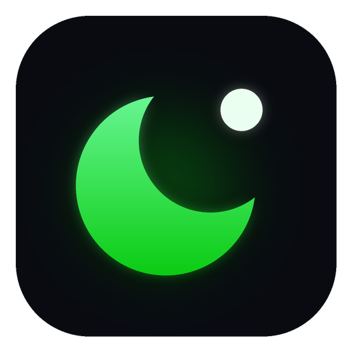
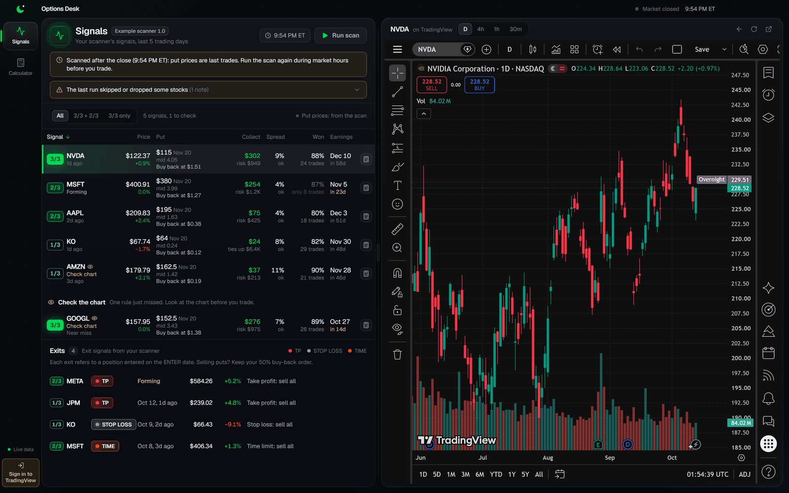
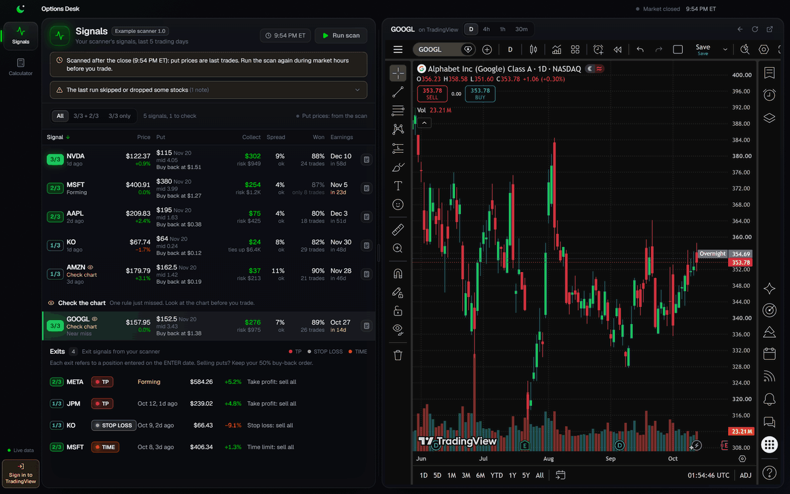
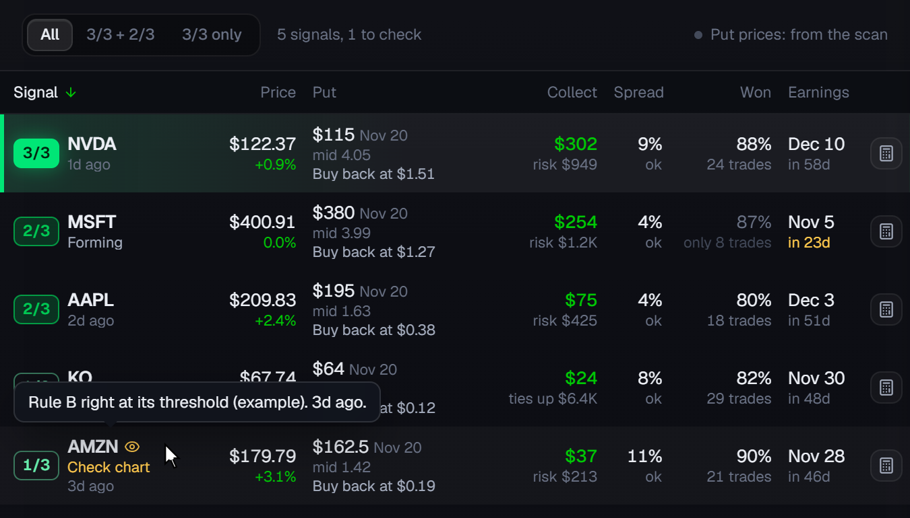
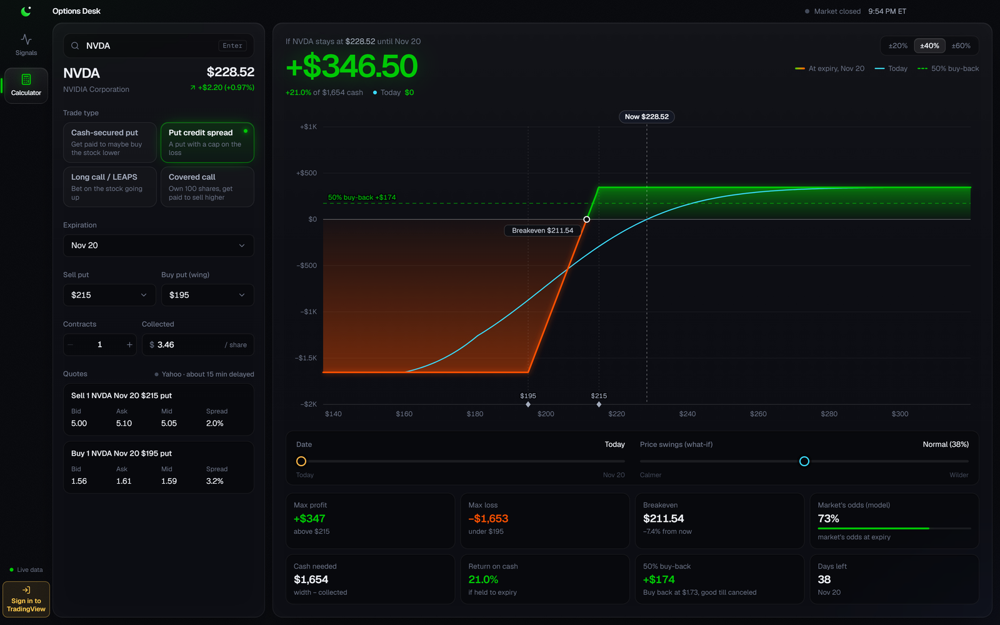
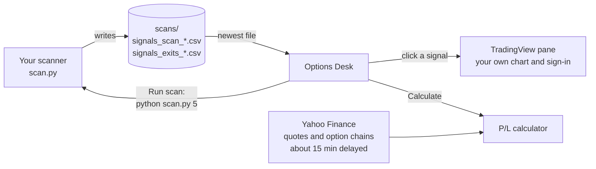

<div align="center">



# Options Desk

**Your own signal scanner, a real TradingView chart and an options profit/loss calculator, in one desktop window.**

[](LICENSE)
[](https://www.electronjs.org/)
[](https://react.dev/)
[](https://www.typescriptlang.org/)
[](#requirements)

<sub>Formerly mission-control.</sub>





<sub>Example data: the signals come from the bundled example scanner and are made up. Charts and option quotes are public market data.</sub>

</div>

## Why

- **Bring your own scanner.** Any script that writes a CSV becomes a live signal list. Options Desk ships no trading
  rules: it shows what *your* scanner finds.
- **The real TradingView, right beside the list.** Click a signal and your own signed-in chart, with your layouts and
  indicators, jumps to that stock. No retyping tickers in another window.
- **Check the trade before you place it.** One click opens the suggested put or put credit spread in a profit/loss
  calculator built on live option chains.

## Features

<table>
<tr>
<td width="46%" valign="top">

### Signals from your scanner

- **Run scan** starts your script, streams its output and can cancel it.
- One row per signal: strength (1/3 to 3/3), price and move, the suggested put or spread, credit and risk, bid/ask gap,
  win rate and next earnings.
- Filter by level, sort any column. Borderline signals and near misses are flagged **Check chart**.
- An exits list for take-profit, stop-loss and time exits.
- Plain warnings for after-hours scans, old scans, missing columns and skipped stocks.

</td>
<td width="54%" valign="top">

</td>
</tr>
<tr>
<td width="54%" valign="top">

</td>
<td width="46%" valign="top">

### Options profit/loss calculator

- Cash-secured put, put credit spread, long call / LEAPS and covered call, on any ticker.
- Strike lists show each option's mid and the model odds it is hit.
- P/L at expiry and on any date before it, plus a what-if slider for bigger or smaller price swings.
- Max profit and loss, breakeven, model odds, cash needed, return on cash and a good-till-canceled buy-back target.
- **Calculate** on any signal row opens that trade, filled in.

</td>
</tr>
<tr>
<td valign="top">

### TradingView pane

- The real tradingview.com in its own pane: sign in once and your session, layouts and indicators stay.
- Daily, 4-hour, 1-hour and 30-minute buttons, a symbol box, back, reload and open-in-browser.
- Works signed out too.

</td>
<td valign="top">

### Built for daily use

- Scans saved outside the app (on a schedule, say) show up when the window regains focus.
- Market times in New York time (ET), with a market open / closed clock.
- Ctrl+1 / Ctrl+2 switch tabs. One copy runs at a time.
- A browser preview with sample data for working on the screens.

</td>
</tr>
</table>

## How it works



The signals table shows your scanner's own prices, from when it ran. Only the calculator fetches prices, from Yahoo.

## Quick start

You need **Node.js 22+** and **Python 3**. In a clone of this repository:

```bash
npm install
npm run dev          # the app, using example-scanner/ as the scanner
```

Press **Run scan**: the example scanner writes made-up signals and the table fills. Click a row to chart it, or
**Calculate** to model the trade. Because the example's prices are fictional, its strikes sit far from the real market
in the calculator; pick other strikes there, or plug in your own scanner.

<details>
<summary><b>The app does not open, or Electron acts like plain Node</b></summary>

Your terminal has `ELECTRON_RUN_AS_NODE` set (some editors' built-in terminals set it). Clear it for the command:

```bash
env -u ELECTRON_RUN_AS_NODE npm run dev                 # bash / Git Bash / macOS / Linux
```

```powershell
Remove-Item Env:ELECTRON_RUN_AS_NODE; npm run dev        # PowerShell
```

The same applies to `npm run build:*`, `npm run capture` and the Playwright smoke test.

</details>

### Requirements

- **Node.js 22 or newer** (and npm).
- **Python 3** for the example scanner (standard library only). Your own scanner can use anything Python can run.
- **Windows 10/11** is the tested platform, and the packaging config builds a Windows installer. Development mode may
  work on macOS and Linux but is untested there.
- An internet connection for TradingView and Yahoo.

## Plug in your own scanner

Options Desk runs whatever `scan.py` you give it and shows what that script saves. Start from
[`example-scanner/scan.py`](example-scanner/scan.py): a self-contained template (standard library, no network) that
writes fictional data in the right format. Then point `MC_SCANNER_DIR` at your folder.

<details>
<summary><b>The contract: how the app runs your script</b></summary>

1. The app runs `python scan.py <days_back>` (`days_back` is 5 by default) with the scanner folder as the working
   directory. Anything you `print` shows up live under the header; print with `flush=True` (the app also sets
   `PYTHONUNBUFFERED=1`).
2. Lines that mention `not scanned`, `no close`, `dropped`, `too new` or `chain unavailable` are kept after the run as
   notes ("The last run skipped or dropped some stocks").
3. Exit with code 0 after writing a **new** `scans/signals_scan_YYYY-MM-DD_HHMM.csv`, stamped with the **New York** time of
   the run. The newest stamp in the file name wins. A non-zero exit, or an exit 0 without a newer file, is shown as a
   failed run together with your script's last output lines.
4. Optionally write `scans/signals_exits_YYYY-MM-DD_HHMM.csv` with the **same** stamp.
5. Write each file under a temporary name and rename it when done, so the app never reads half a file. Write the
   exits file before the scan file.
6. A run is stopped after 15 minutes. Cancel stops your script and everything it started.

You can also run your scanner on a schedule outside the app: the Signals tab re-reads the newest files when it opens and
when the window comes back into focus.

</details>

<details>
<summary><b>Signals CSV columns</b> (<code>scans/signals_scan_YYYY-MM-DD_HHMM.csv</code>)</summary>

One row per signal, with a header row. Column order does not matter and extra columns are ignored. Empty cells and
`nan`, `none`, `null` read as blank. Booleans are `True` / `1` / `yes`, anything else is false. Dates are `YYYY-MM-DD`
(a trailing time such as `00:00:00` is ignored).

"Required" columns: a row without them is skipped and counted. "Expected" columns: if the file lacks one, the app shows a
warning naming it.

| Column | Need | Example | Meaning |
| --- | --- | --- | --- |
| `ticker` | required | `AAPL` | Symbol, Yahoo style (class shares with a dash: `BRK-B`; the chart converts it). |
| `level` | required | `2/3` | Signal strength 1 to 3, written `N/3` or just `N`. A column named `lv` is accepted instead. |
| `kind` | required | `tagged` | `tagged` (fired on a closed bar), `forming` (may fire at today's close) or `near` (just missed; listed under "Check the chart"). |
| `date` | required | `2026-03-09` | Day the signal fired. |
| `days_ago` | required for `tagged` | `2` | Trading days since the signal (0 = today). Ignored for `forming` and `near`. |
| `price_then` | required | `215.10` | Price on the signal day. |
| `price_now` | required | `212.40` | Latest price. |
| `won_pct` | expected | `95.5` | The stock's historical win rate at this level, in percent. |
| `trades` | expected | `22` | How many trades `won_pct` rests on (under 10 is greyed out). |
| `next_earn` | expected | `2026-04-30` | Next earnings date (highlighted when it comes before the put expires). |
| `borderline` | expected | `False` | `True` = right at the edge of a rule: flagged "Check chart". |
| `detail` | optional | `Rule B right at its threshold` | Why it is borderline or a near miss (tooltip). |
| `put_exp` | expected | `2026-04-17` | Expiration of the suggested put. Without `put_exp` and `put_strike` the row shows "No put found". |
| `put_strike` | expected | `195` | Strike of the put to sell. |
| `put_bid`, `put_ask` | optional | `2.10`, `2.24` | Quote of that put when the scan ran. |
| `put_mid` | expected | `2.17` | Mid price, or the last trade when there was no live quote. |
| `put_spread` | optional | `0.0645` | (ask - bid) / mid as a **fraction**; above `WIDE_SPREAD` it is flagged "wide". |
| `put_delta` | optional | `-0.20` | Delta of the put. |
| `put_note` | optional | `market closed: last trade price` | Free text; a note containing "market closed" or "chain unavailable" gets a plain explanation. |
| `put_wing_strike` | optional | `185` | Strike of the bought put, for a put credit spread. |
| `put_wing_mid` | optional | `0.95` | Mid of the bought put. |
| `put_credit` | optional | `1.22` | Spread credit per share at the mids (`put_mid - put_wing_mid`). |
| `put_width` | optional | `10` | `put_strike - put_wing_strike`. With credit and width the row shows a spread; without, a cash-secured put. |
| `put_buyback` | optional | `0.61` | Good-till-canceled buy-back price per share. Default: `TAKE_PROFIT_LEFT` x `put_mid`. |
| `put_live` | optional | `True` | Whether the quote was a live bid/ask. Default: true when bid and ask are both above 0. Rows without a live quote are greyed out. |
| `tested_won`, `tested_avg` | optional | `80`, `1.5` | Your own backtest of every signal at this level, cash-secured put: percent won, and average profit per trade as a percent of the cash it ties up. Shown as "Scanner backtest" only when present. |
| `tested_spread_won`, `tested_spread_mid`, `tested_spread_natural` | optional | `75`, `6`, `-2` | The same backtest for the credit spread: percent won, average result as a percent of max loss at the mids, and at bid/ask prices. |
| `scanner` | optional | `My scanner 2.1` | Your scanner's name and version, shown next to the title. |

Two example rows (made up), with the required and the most useful optional columns:

```csv
ticker,level,kind,date,days_ago,price_then,price_now,won_pct,trades,next_earn,borderline,detail,put_exp,put_strike,put_bid,put_ask,put_mid,put_wing_strike,put_wing_mid,put_credit,put_width,scanner
NVDA,3/3,tagged,2026-03-10,1,121.30,122.37,88.0,24,2026-04-28,False,,2026-04-17,115,3.95,4.15,4.05,105,1.02,3.03,10,My scanner 1.0
AMZN,1/3,tagged,2026-03-06,3,174.40,179.79,90.0,21,2026-04-30,True,Rule B right at its threshold,2026-04-17,162.5,1.38,1.46,1.42,155,0.45,0.97,7.5,My scanner 1.0
```

</details>

<details>
<summary><b>Exits CSV columns</b> (<code>scans/signals_exits_YYYY-MM-DD_HHMM.csv</code>)</summary>

Same stamp as the scan file. All columns except `forming` are required.

| Column | Example | Meaning |
| --- | --- | --- |
| `ticker` | `JPM` | Symbol. |
| `level` | `1/3` | Level of the signal the position came from (or `lv`). |
| `enter` | `2026-02-10` | Entry date. |
| `enter_price` | `230.50` | Entry price. |
| `tag` | `TP` | `TP` (take profit, sell all), `TP 1` / `TP 2` (two-step take profit: half, then the rest), `STOP LOSS` or `TIME`. Rows with any other tag are skipped. |
| `date` | `2026-03-10` | Exit date. |
| `days_ago` | `1` | Trading days since the exit (not needed when `forming` is true). |
| `price` | `241.60` | Price at the exit. |
| `move` | `0.048` | `price / enter_price - 1`, as a **fraction**. |
| `forming` | `False` | `True` = the exit may fire at today's close. |

Example rows (made up):

```csv
ticker,level,enter,enter_price,tag,date,days_ago,price,move,forming
JPM,1/3,2026-02-10,230.50,TP,2026-03-10,1,241.56,0.048,False
KO,1/3,2026-02-04,73.10,STOP LOSS,2026-03-09,2,66.45,-0.091,False
```

</details>

## Configuration

| Environment variable | Default | What it does |
| --- | --- | --- |
| `MC_SCANNER_DIR` | development: `<repo>/example-scanner`; installed app: `<home>/OptionsDesk/scanner` | The folder that holds `scan.py`. Its CSVs go in `scans/` inside it. |
| `MC_PYTHON` | `python` on Windows, `python3` elsewhere (from `PATH`) | Full path to the Python that runs the scanner. |

If the scanner folder or `scan.py` is missing, the Signals tab says so and names the folder it looked in.

The app keeps its own data in the settings folder `Options Desk` under your app-data folder (`%APPDATA%` on Windows):
the TradingView session and a small log, `logs/main.log` (rolled over at 1 MB).

<details>
<summary><b>Trading defaults</b> (one file: <a href="src/shared/defaults.ts"><code>src/shared/defaults.ts</code></a>)</summary>

The put delta per signal level (3/3: 0.30, 2/3: 0.20, 1/3: 0.15), the delta for a typed ticker (0.30), the spread's
bought put (0.10 delta), the take-profit buy-back (50% of what you collected), the "wide" bid/ask threshold (15% of the
mid), how many trading days the scanner is asked to look back (5), and the trade count under which a win rate is greyed
out (10). They are common conventions, not recommendations: change them to match your own rules.

</details>

## Development

```bash
npm run dev:web      # the screens alone in a browser with sample data: http://127.0.0.1:5199
npm test             # unit tests (Vitest)
npm run typecheck    # TypeScript, main and renderer
npm run build && npx playwright test e2e   # smoke test of the built app
npm run build:dir    # unpacked Windows app in dist/win-unpacked/OptionsDesk.exe
npm run build:win    # Windows installer in dist/
npm run capture      # rebuild the README images in docs/images/ (needs Pillow: pip install pillow)
```

<details>
<summary><b>Details</b></summary>

- In the browser preview, `?mock=live` opens the market-hours sample scan, `?tv=out` shows the signed-out TradingView
  state, and `?clock=open` / `?clock=closed` move the app clock to 10:30 AM / 7:00 PM ET.
- The smoke test launches the built app with a fresh copy of the example scanner, runs a scan, opens the chart and the
  calculator, and fails on any error on the app page. It needs Python 3 and an internet connection.
- `npm run capture` drives the built app at 1600 x 1000 against the example scanner and composites the TradingView view
  into the window images ([`e2e/capture.spec.ts`](e2e/capture.spec.ts), [`scripts/build_images.py`](scripts/build_images.py)).
  It refuses to run while TradingView is signed in inside the app, so no account ever shows up in the images, and it
  switches that signed-out TradingView session to the dark theme. `OD_CAPTURE_SCALE` (default 2) sets the capture's pixel
  density.
- Close Options Desk before `build:dir`, `build:win`, the smoke test or `capture`: the app allows one copy at a time, and
  a running copy can't be replaced (the build script checks).

</details>

## FAQ

<details>
<summary><b>Does Options Desk place trades or connect to a brokerage account?</b></summary>

No. It never places orders and never asks for a brokerage login. It shows your scanner's results, a chart and a
calculator; you trade wherever you trade.

</details>

<details>
<summary><b>Do I need a TradingView account?</b></summary>

No. The chart works signed out. Sign in (the rail's **Sign in to TradingView** button) to get your saved layouts,
indicators and whatever your TradingView plan includes. The sign-in happens on TradingView's own pages.

</details>

<details>
<summary><b>Where do the prices come from?</b></summary>

The signals table shows the prices your scanner wrote, from when it ran. The calculator fetches quotes and option chains
from Yahoo through the unofficial [`yahoo-finance2`](https://github.com/gadicc/node-yahoo-finance2) library: about 15
minutes delayed for options.

</details>

<details>
<summary><b>Can my scanner be written in another language?</b></summary>

The app runs `python scan.py`, but `scan.py` can be a few lines that start your real scanner (any language) and wait
for it, as long as the CSV files end up in `scans/`.

</details>

<details>
<summary><b>Does it run on macOS or Linux?</b></summary>

Development mode (`npm run dev`) may work, but it is untested there, and the packaging config only builds for Windows.

</details>

<details>
<summary><b>Upgrading from the earlier name?</b></summary>

The settings folder is now `Options Desk` and the installed app's default scanner folder is `<home>/OptionsDesk/scanner`.
Sign in to TradingView once more, and move your scanner folder there (or point `MC_SCANNER_DIR` at it).

</details>

<details>
<summary><b>Troubleshooting</b></summary>

- **"No scanner found"** on the Signals tab: set `MC_SCANNER_DIR` to the folder that holds your `scan.py` (or copy
  `example-scanner/scan.py` there) and open the app again.
- **"Python was not found"**: install Python 3, or set `MC_PYTHON` to its full path. On Windows, the Microsoft Store
  `python` shortcut does not count.
- **Google refuses the sign-in inside the app**: set a password on your TradingView account (Profile, then Password) and
  sign in with email instead.
- **A blank window or other oddities**: look in `logs/main.log` in the app's settings folder.

</details>

## Security notes

- **Renderer locked down.** The app page runs with `contextIsolation`, `sandbox` and no Node integration, under a strict
  Content-Security-Policy. It reaches the main process only through a small preload bridge (`window.mc`); every IPC call
  is accepted only from the app's own page, and every argument is validated in the main process.
- **Links** leave the app only as `http(s)` pages, opened in your default browser.
- **TradingView** loads the real tradingview.com in its own view and its own persistent session (separate from the app
  page). You sign in with your own TradingView account on TradingView's own pages; the app never sees your password. It
  only checks whether TradingView's session cookie exists, to show "TV signed in". The view may use the clipboard and
  fullscreen, nothing else (no camera, microphone, location or notifications). Sign-in pop-ups (TradingView, Google,
  Apple, Facebook, X) stay in the app so the session is shared; any other link opens in your browser.
- **Switching the chart**: when you click a row, the app runs a short script in the TradingView page that switches the
  symbol and interval through TradingView's page API when it is present; otherwise it loads the chart's address.
- **Packaged builds** turn on Electron fuses: the executable can't run as plain Node, ignores `NODE_OPTIONS` and
  `--inspect`, encrypts its cookies, and only loads its own integrity-checked `app.asar`.
- **One copy at a time** (single-instance lock), so two windows never fight over the session or the scan files.
- **Logs** stay on your computer. Each line is cleaned before it is written: long token-like strings become `[hidden]`
  and account-number-like strings keep only their last 4 characters.
- **Your scanner is your code.** The app runs `scan.py` from the folder you choose with your own user's permissions. Only
  point `MC_SCANNER_DIR` at code you trust.

## Disclaimer

This software is for information and education only. It is **not financial advice**, and nothing in it is a
recommendation to buy or sell any security or option. Options involve substantial risk and are not suitable for everyone;
you can lose more than you expect. The example scanner's data is fictional. Model numbers such as "Market's odds" are
estimates from a pricing model, not predictions. Check every price with your broker before you trade. You are solely
responsible for your trades.

Options Desk is an independent project. It is **not affiliated with, endorsed by or sponsored by TradingView or Yahoo**.
Market data comes from Yahoo through the unofficial [`yahoo-finance2`](https://github.com/gadicc/node-yahoo-finance2)
library: it is delayed (about 15 minutes for options), may be incomplete or wrong, and may stop working if Yahoo changes
its service. Use of TradingView and Yahoo is subject to their own terms.

## License

[MIT](LICENSE)
